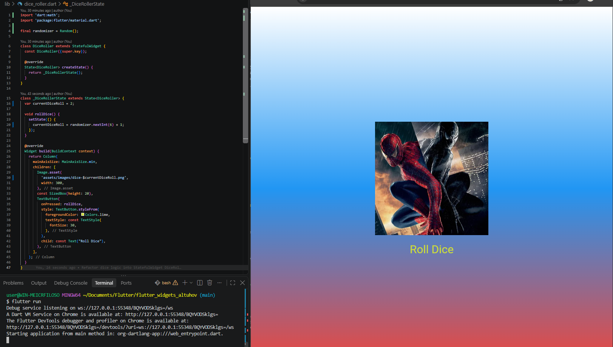

# Лабораторная работа №4-5. Flutter

* **Студент:** Алтухов Павел Сергеевич
* **Группа:** ИСП-241
* **Дата сдачи:** 2026-10-28
* **Ссылка на репозиторий:** [GitHub](https://github.com/youngest0daughter/Flutter_Widgets)

## Что изучили:
1. Построение пользовательского интерфейса через иерархию стандартных виджетов (`Scaffold`, `Container`, `Column`, `Center`).
2. Разделение монолитного кода на логические классы-виджеты и распределение их по отдельным файлам.
3. Передача параметров и данных между компонентами через конструкторы с использованием ключевого слова `final`.
4. Управление динамическим состоянием интерфейса с помощью `StatefulWidget` и метода `setState()`.
5. Интеграция статических медиаресурсов (`assets`) и генерация псевдослучайных чисел (`dart:math`).

## Скриншот финального приложения

## Ответы на вопросы:
1. Для повышения читаемости кода, соблюдения принципов модульности, переиспользования компонентов в разных частях приложения и удобства командной разработки.
2. Это объект, который указывает на местоположение виджета в дереве виджетов и позволяет получать доступ к системным настройкам, темам и медиа-данным.
3. `StatelessWidget` неизменяем после отрисовки (статичный UI), в то время как `StatefulWidget` имеет изменяемое состояние (`State`) и может перерисовывать интерфейс при вызове `setState()`.
4. Чтобы не пересоздавать новый объект генератора в памяти при каждом нажатии кнопки, что оптимизирует производительность приложения.